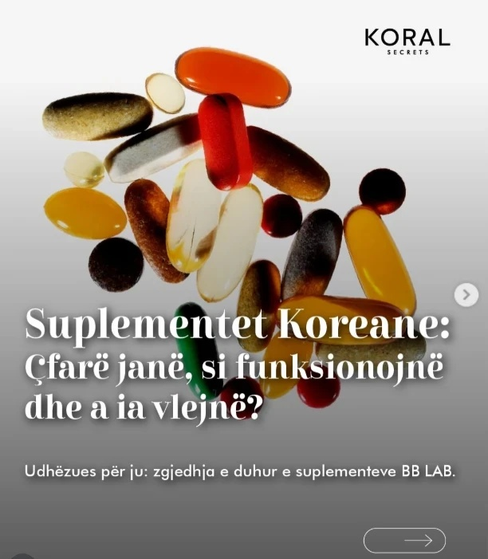
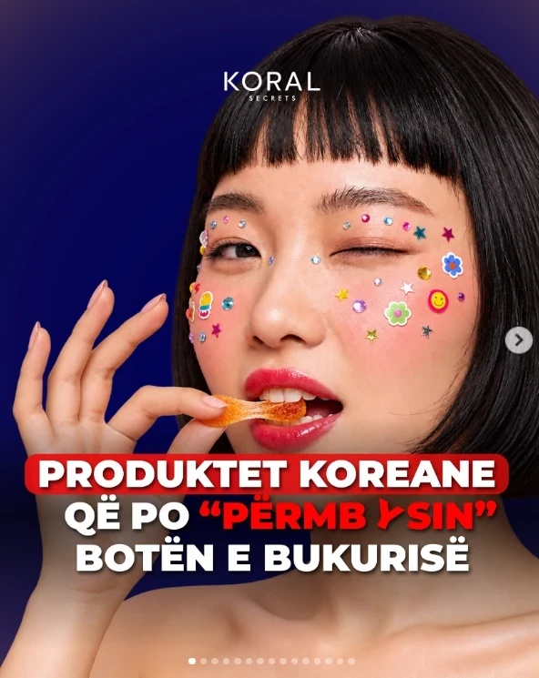
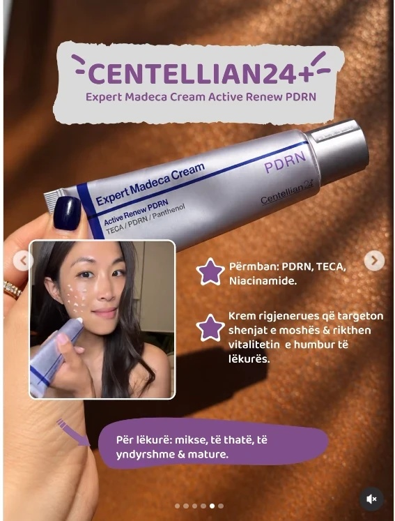
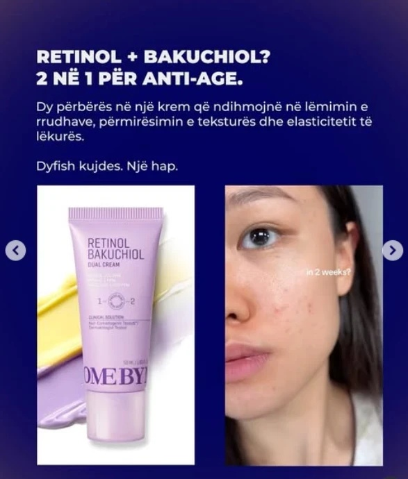

# Koral Secrets

### Digital Marketing | Public Relations | Brand Communication

## Project Overview

A selection of creative marketing and communication
materials for Koral Secrets, focused on Korean
beauty and skincare in the Albanian market.

## Project Details

- Industry: Beauty & Skincare
- Market: Albania
- Language: Albanian
- Channels: Social Media & Website

## Communication Objectives

- Brand awareness
- Consumer education
- Product communication
- Creative storytelling
- Audience engagement

## Selected Social Media Content

### Korean Supplements

### Korean Beauty Trends

### Centellian24+ Hydra Calming

### Centellian24+ Active Renew PDRN

### Retinol & Bakuchiol

## Editorial & Blog Content

### SUNGBOON EDITOR

Editorial content focused on Korean beauty,
brand storytelling and product communication.

[Read the published article](https://koralsecrets.al/blogs/news/sungboon-editor-marka-koreane-qe-redaktoi-standardet-e-skincare-it-modern-1)

## Marketing Areas

- Creative Copywriting
- Content Marketing
- Public Relations
- Brand Communication
- Social Media Content
- Editorial Storytelling

## Brand Website

[Visit Koral Secrets](https://koralsecrets.al/)

---

Selected Work | Professional Marketing Portfolio
