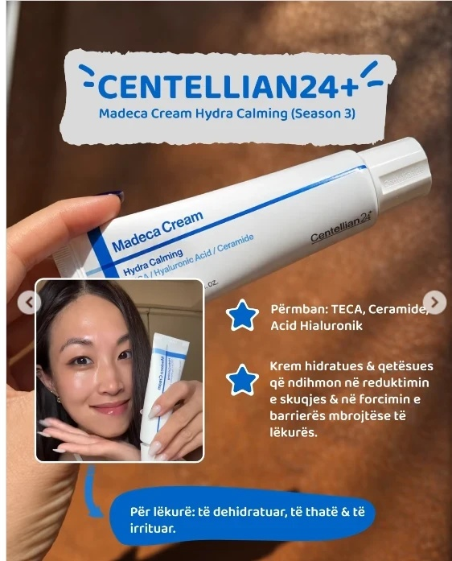
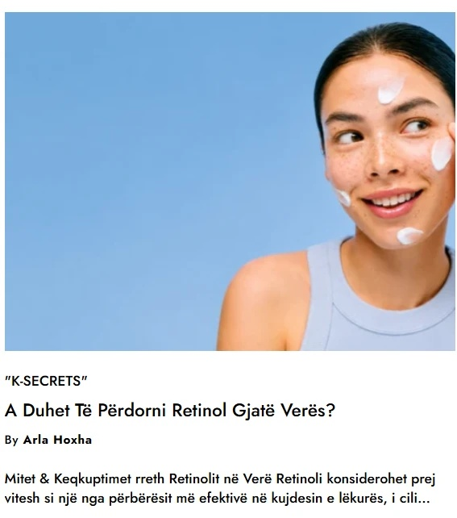
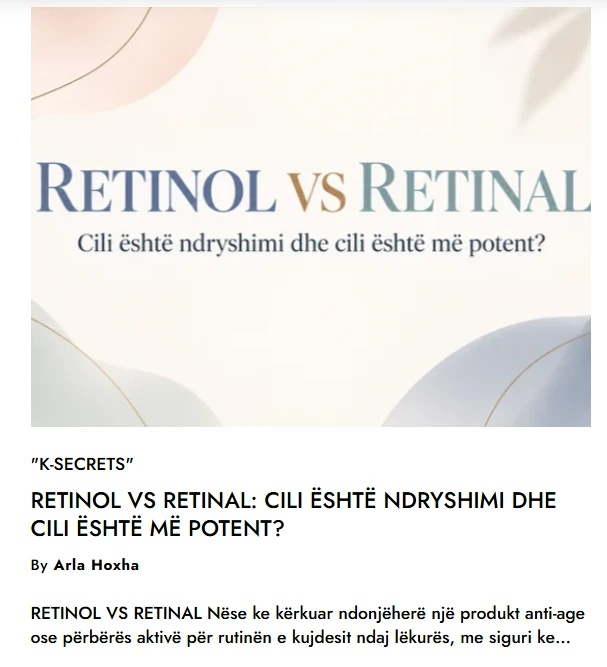

# KORAL SECRETS

### Digital Marketing | Public Relations | Creative Communication

**Professional Portfolio — Arla Hoxha**

---

## Project Overview

A curated collection of digital marketing, social media content and editorial communication for Koral Secrets, focused on Korean beauty and skincare in the Albanian market.

The selected materials illustrate the combination of creative storytelling, visual communication and consumer education within the beauty industry.

| Project Details | |
|---|---|
| Brand | Koral Secrets |
| Industry | Beauty & Skincare |
| Target Market | Albania |
| Content Language | Albanian |
| Channels | Social Media & Website |

---

## 01 — Social Media & Creative Content

### Korean Supplements

**Content Type:** Educational Carousel

**Creative Concept:** An educational carousel introducing Korean supplements and BB LAB products. Floating capsules and elegant editorial typography create a visually engaging composition.

**Communication Objective:** Generate curiosity, introduce the product category and make product information more accessible to consumers.

---

### Korean Beauty Trends

**Content Type:** Trend-Based Social Media Content

**Creative Concept:** A bold, trend-driven visual combining vibrant colors, playful beauty imagery and expressive typography.

**Communication Objective:** Capture audience attention, introduce Korean beauty trends and encourage exploration of new products.

---

### Centellian24+ — Hydra Calming

**Content Type:** Product Education

**Creative Concept:** A product-focused composition combining lifestyle imagery, product photography and blue graphic elements to organize ingredient and skincare information.

**Communication Objective:** Simplify product information and help consumers understand its intended use and positioning.

---

### Centellian24+ — Active Renew PDRN

**Content Type:** Product Spotlight

**Creative Concept:** A visually coordinated product presentation using purple accents, close-up photography and application imagery.

**Communication Objective:** Differentiate the product within the skincare range and communicate its key features through concise visual storytelling.

---

### Retinol & Bakuchiol

**Content Type:** Educational Product Communication

**Creative Concept:** An educational visual combining contrasting colors, product imagery and concise copy to introduce a dual-ingredient skincare formula.

**Communication Objective:** Make ingredient-focused skincare communication accessible and engaging for the target audience.

---

## 02 — Editorial & Blog Content

A selection of published Albanian-language articles focused on beauty education, brand storytelling and consumer-oriented communication.

### SUNGBOON EDITOR — Brand Storytelling

An editorial feature introducing a Korean skincare brand, its identity and positioning within modern beauty culture.

**Content Focus:**
- Brand storytelling
- Editorial communication
- Beauty trends
- Product awareness

[Read the full published article →](https://koralsecrets.al/blogs/news/sungboon-editor-marka-koreane-qe-redaktoi-standardet-e-skincare-it-modern-1)

---

### Should You Use Retinol During Summer?

**Author:** Arla Hoxha

An educational article addressing common questions and misconceptions surrounding retinol use during the summer season.

**Content Focus:**
- Educational copywriting
- Seasonal content marketing
- Consumer awareness
- Skincare communication

[Read the full published article →](https://koralsecrets.al/blogs/news/a-duhet-te-perdorni-retinol-gjate-veres)

---

### Retinol vs Retinal — What Is the Difference?

**Author:** Arla Hoxha

A comparative editorial article presenting the differences between retinol and retinal through accessible, consumer-focused writing.

**Content Focus:**
- Editorial copywriting
- Comparative content
- Product education
- Beauty communication

[Read the full published article →](https://koralsecrets.al/blogs/news/retinol-vs-retinal-cili-eshte-ndryshimi-dhe-cili-eshte-me-potent)

---

## 03 — Professional Competencies

- Public Relations
- Digital Marketing
- Creative Copywriting
- Content Marketing
- Brand Storytelling
- Visual Communication
- Social Media Content
- Editorial Writing
- Product Communication
- Localized Marketing Communication

---

## Communication Approach

The selected work illustrates an approach that combines creativity, audience-oriented messaging and educational storytelling.

The content is designed to translate beauty and skincare topics into engaging, accessible communication for the Albanian audience.

---

## Brand Website

[Visit Koral Secrets →](https://koralsecrets.al/)

---

## Professional Portfolio

**Arla Hoxha**

Public Relations | Marketing | Brand Communication

Selected work presented for professional portfolio purposes.

